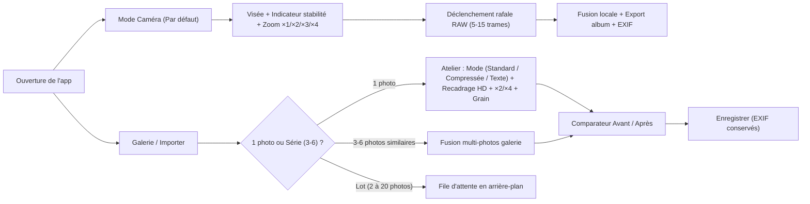

# Cahier des charges — App Android « PixR »

**Positionnement :** Application Android de photographie et d'amélioration d'images **100 % hors-ligne** et **100 % fidèle à la prise réelle**. Elle augmente le nombre de pixels et la propreté des photos à deux niveaux (à la prise de vue et sur photos existantes) **sans jamais recourir à l'IA générative** ni modifier un grain de la scène réelle.

---

## 1. Principes non négociables

1. **Zéro cloud, zéro envoi de données :** tous les calculs s'exécutent localement sur le téléphone (GPU / NPU). L'application fonctionne en mode avion.
2. **Zéro invention (fidélité stricte) :** aucune IA générative (pas de reconstruction imaginaire de visages ou de textures). Uniquement :
   - **Fusion multi-trames RAW** (récupération de vrais détails physiques via les micro-mouvements).
   - **Super-résolution analytique / non générative** (modèles légers optimisés pour la fidélité mathématique pixel par pixel — *PSNR*, mesure d'écart exact avec l'image d'origine).
3. **Simplicité d'usage :** interface épurée à deux entrées claires (**Prendre une photo** / **Améliorer une photo**), sans jargon pro obligatoire.

---

## 2. Périmètre fonctionnel

### Niveau 1 — Pendant la prise de vue (4 fonctionnalités)

| ID | Fonctionnalité | Description fonctionnelle | Critère d'acceptation |
| :--- | :--- | :--- | :--- |
| **C1** | **Rafale RAW haute fidélité** | Un appui sur le déclencheur capture automatiquement 5 à 15 images brutes (*RAW/DNG*), les aligne au sous-pixel près et les fusionne avant création des couleurs (*démosaïçage*) pour produire directement une photo finale plus définie et moins bruitée. | Le fichier produit est directement l'image finale améliorée (sans conserver de doublon brut). |
| **C2** | **Zoom propre (×2, ×3, ×4)** | En zoomant dans le viseur, la rafale RAW reconstruit des détails réels sur la zone cadrée au lieu d'un agrandissement numérique flou. | Netteté visiblement supérieure à un zoom numérique classique sur la même cible. |
| **C3** | **Indicateur de stabilité en direct** | Repère visuel discret dans le viseur alimenté par les capteurs de mouvement du téléphone (*gyroscope*) indiquant si la tenue est assez stable pour la fusion. | L'indicateur passe au vert/stable ou orange/instable en temps réel (< 100 ms). |
| **C4** | **Mode « Texte / Scène lointaine »** | Raccourci rapide dans le viseur qui privilégie une vitesse rapide et un alignement haute précision pour lire un panneau, un tableau ou un document éloigné. | Texte lointain lisible sans altération de chiffres ou de lettres. |

> *Décision produit :* pas d'option de double sauvegarde (brut + amélioré) dans cette version ; l'app enregistre uniquement la photo finale améliorée.

---

### Niveau 2 — Après la prise : Photos existantes (Socle + 7 fonctionnalités)

#### Socle obligatoire
- **Import galerie :** JPEG, PNG, HEIC, DNG/RAW.
- **Facteur d'agrandissement :** choix **×2** ou **×4**, avec affichage avant lancement de la résolution finale (en mégapixels) et du poids estimé (en Mo).
- **Comparateur Avant / Après :** curseur glissant sur l'écran avec zoom libre jusqu'à 100 % pixel par pixel.
- **Export propre :** sauvegarde dans un album dédié en PNG sans perte ou JPEG haute qualité (95–100 %).

#### Les 7 fonctionnalités retenues

| ID | Fonctionnalité | Description fonctionnelle |
| :--- | :--- | :--- |
| **P1** | **Fusion multi-photos galerie (« Rafale a posteriori »)** | Sélectionner 3 à 6 photos quasi identiques déjà présentes dans la galerie → alignement et fusion locale pour récupérer de vrais détails et réduire le bruit. |
| **P2** | **Agrandissement ciblé (*Recadrage HD*)** | Encadrer uniquement la zone utile (sujet lointain, visage en arrière-plan, détail) et n'agrandir que cette partie pour gagner du temps et éviter des fichiers géants. |
| **P3** | **Mode « Photo compressée »** | Pré-nettoyage des défauts de compression (carrés *JPEG* et halos autour des bords) fréquents sur WhatsApp, Instagram ou captures d'écran avant agrandissement. |
| **P4** | **Curseur « Grain d'origine »** | Réglage simple (0–100 %) pour doser la préservation de la texture fine du capteur et éviter tout aspect lisse/plastique. |
| **P5** | **Mode « Texte & Documents »** | Nettoyage et renforcement fidèle des contours de lettres et contrastes sur factures, notes ou tableaux sans modifier aucun caractère. |
| **P6** | **Traitement par lot en arrière-plan** | Sélectionner plusieurs photos (file d'attente hors-ligne) avec pause automatique si le téléphone chauffe trop ou si la batterie est critique. |
| **P7** | **Conservation stricte des métadonnées (*EXIF*)** | Recopie intégrale de la date, lieu GPS, modèle d'appareil, ouverture et sensibilité ISO, avec ajout d'une mention claire du traitement effectué (ex. `×2 fidèle, 0 % génératif`). |

---

## 3. Parcours utilisateur



---

## 4. Architecture d'interface (Exemples d'écrans)

### Écran 1 — Appareil photo (Capture)
*Thème sombre intégral (contraste neutre pour ne pas fausser les couleurs perçues).*

```text
+------------------------------------------+
|  [Mode: Photo Fidèle]   [Texte/Loin] [?] |
|                                          |
|          +--------------------+          |
|          |   Aperçu viseur    |          |
|          |     en direct      |          |
|          |                    |          |
|          |   [• Stable ✓]     |          |
|          +--------------------+          |
|                                          |
|         (1x)   [2x]   (3x)   (4x)        |
|                                          |
|   [Galerie]     (( 📷 ))     [Lot (0)]   |
+------------------------------------------+
```

### Écran 2 — Atelier Photo existante & Comparateur
```text
+------------------------------------------+
|  <- Retour      Photo_2026.jpg   [Info]  |
|                                          |
|  +------------------+------------------+ |
|  |      AVANT       |       APRÈS      | |
|  |   12 MP (orig.)  |   48 MP (×2)     | |
|  |        <--------[||]-------->       | |
|  +------------------+------------------+ |
|  Zoom : 100 % (pincer pour inspecter)    |
|------------------------------------------|
|  [Recadrer HD]   Mode: [Standard v]      |
|  Facteur :  ( ×2 )   [ ×4 ]              |
|  Grain d'origine :  ----●--------- 70 %  |
|  Sortie estimée : 48 MP • ~14 Mo • EXIF✓ |
|------------------------------------------|
|        [ Enregistrer dans la galerie ]   |
+------------------------------------------+
```
*(Les options du sélecteur `Mode` sont : Standard fidèle, Photo compressée, Texte & Documents).*

### Écran 3 — Fusion multi-photos & Traitement par lot
```text
+------------------------------------------+
|  <- Retour       File & Multi-photos     |
|------------------------------------------|
|  [Mode Fusion (3-6 photos similaires)]   |
|  [img1] [img2] [img3] [img4]             |
|  Alignement auto prêt • 0 % invention    |
|  [ Lancer la fusion ]                    |
|------------------------------------------|
|  TRAITEMENT PAR LOT (Hors-ligne)         |
|  • IMG_0412.jpg (×2 Compressée)  [Fait ✓]|
|  • IMG_0413.jpg (×2 Standard)   [65 %.. ]|
|  • IMG_0414.jpg (×4 Texte)      [Attente]|
|  Température OK • Pause si batterie <15% |
+------------------------------------------+
```

---

## 5. Architecture technique Android (100 % locale)

| Couche | Technologie recommandée | Rôle |
| :--- | :--- | :--- |
| **Interface (UI)** | **Kotlin + Jetpack Compose** (Material 3) | Écrans fluides, comparateur tactile Avant/Après, recadrage. |
| **Caméra & Capteurs** | **Android Camera2 API** + `SensorManager` | Capture rafale `RAW_SENSOR` (DNG), contrôle exposition/vitesse, lecture gyroscope. |
| **Calcul haute performance** | **C++ (Android NDK) + Vulkan Compute Shaders** | Alignement sous-pixellaire, fusion multi-trames, démosaïçage et traitement par tuiles (*tiling* avec chevauchement). |
| **IA locale non générative** | **LiteRT (ex-TFLite)** avec délégués **GPU (Vulkan) / NPU** | Exécution locale en `FP16` de modèles légers orientés *PSNR* (ex. architecture type WDSR/EDSR compacte) + anti-artefacts JPEG. |
| **Tâches en arrière-plan** | **WorkManager** + suivi thermique (`PowerManager`) | Exécution des lots hors-ligne sans faire chauffer ou planter le téléphone. |
| **Métadonnées** | **AndroidX ExifInterface** | Recopie exacte des données EXIF + écriture propre du tag de traitement. |

---

## 6. Contraintes matérielles & Risques à anticiper

1. **Accès RAW variable sur Android :** certains téléphones d'entrée de gamme n'exposent pas le flux `RAW_SENSOR` via Camera2.
   - *Parade :* vérification automatique au premier lancement. Si le RAW est bloqué sur l'appareil, l'app l'indique clairement et bascule la capture sur une rafale YUV/JPEG haute qualité (moins efficace que le RAW, mais fonctionnelle), tandis que le module **Photos existantes** reste 100 % opérationnel.
2. **Mémoire vive (RAM) sur gros capteurs :** passer une photo de 50 MP en ×4 donnerait 800 MP (impossible sur téléphone).
   - *Parade :* traitement systématique par **tuiles en `FP16`**, et limite raisonnable affichée à l'écran (ex. plafond à ~64–100 MP en sortie, avec suggestion automatique d'utiliser le **Recadrage HD** sur les très grandes photos).
3. **Chauffe & autonomie :** plusieurs agrandissements ×4 d'affilée sollicitent fortement le processeur graphique.
   - *Parade :* gestion de file d'attente qui espace ou met en pause le lot si l'API thermique Android signale une chauffe modérée/sévère.

---

## 7. Plan de réalisation conseillé (par étapes)

1. **Étape 1 — Prototype moteur image (Atelier photo existante) :** import galerie, découpage en tuiles, modèle non génératif ×2/×4 + mode Compressée + EXIF + comparateur Avant/Après.
2. **Étape 2 — Ajouts galerie avancés :** Recadrage HD, curseur Grain d'origine, mode Texte & Documents, traitement par lot.
3. **Étape 3 — Module Caméra & Fusion :** viseur Camera2, indicateur gyroscope, rafale RAW + fusion sous-pixellaire (puis réutilisation de ce même moteur pour la fusion multi-photos de la galerie).
4. **Étape 4 — Tests terrain multi-téléphones :** mesure des temps de calcul, température et fidélité visuelle sur au moins 2–3 gammes d'appareils Android.
